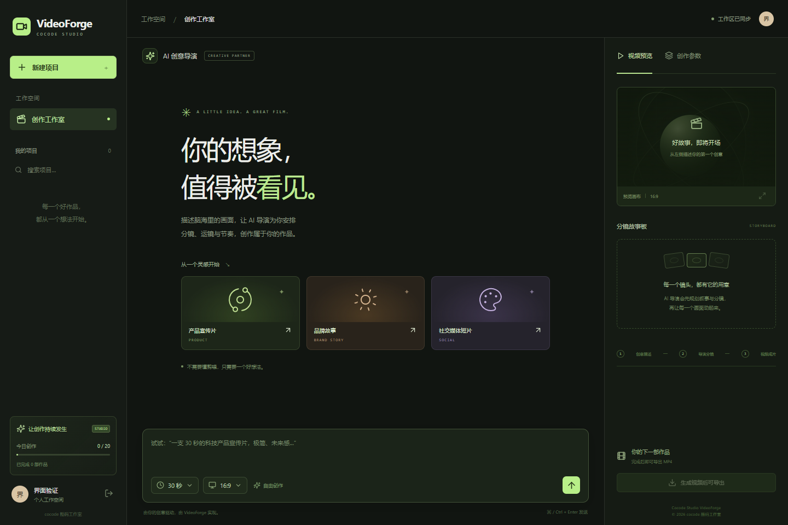

由 **cocode 酷码工作室** 开发，品牌归属 **cocode**。

<h1 align="center">Cocode Studio VideoForge</h1>
<p align="center">把一句创意，变成有叙事、有运镜、有节奏的视频。</p>

基于 DeepSeek / Cordis 的自主视频创作 Harness。React 工作室展示流式 AI 消息和作品，DeepSeek 操作持续工程工作区，自主读取技能、寻找或制作素材、写代码、运行预览、修复并交付。支持浏览器图形、Remotion、Blender、Python、FFmpeg 和多种配音服务。所有产品能力由三个自有插件提供，没有修改 DSH 核心源码。实现、环境准备与能力边界见 [创作 Harness](docs/creative-harness.md)。

完整服务器操作步骤见 [部署手册](DEPLOYMENT.md)，覆盖 Windows、Linux systemd、Docker、Nginx、备份恢复与排错。源码交付包含 [官方 DSH 源码与来源记录](vendor/dsh/README.md)。

中文详细介绍与教程提示词迁移说明见 [项目导览](docs/project-guide-zh.md)。默认创作入口已接入教程十条方法的 [中文提示词工程指南](vendor/creative-skills/prompt-engineering/SKILL.md)，并保留原文完整阅读。

工作室消息先由独立 AI 润色，并通过动画展示准备与结果；默认由 AI 根据需求规划视频规格，也可手动指定。默认 Harness 在完整读取全部技能入口、教程和工程 Markdown 参考之前禁止创作工具执行。



## 本地部署

新部署推荐 **Node.js 22 最新维护版（至少 22.19）、npm、FFmpeg / FFprobe、Chrome Headless Shell**。建议 Linux 主机至少 4 核 / 8 GB 内存；渲染默认单任务串行。

```bash
npm ci
cp .env.example .env
```

Windows PowerShell：

```powershell
npm ci
Copy-Item .env.example .env
```

编辑 `.env`，配置服务端模型凭证：

```dotenv
DEEPSEEK_MODEL=deepseek-flash
DEEPSEEK_BASE_URL=https://api.deepseek.com
DEEPSEEK_API_KEY=填写你的服务端密钥
PUBLIC_ORIGIN=http://localhost:3088
```

默认模型 `deepseek-flash` 对应 DeepSeek V4.1 Flash。注册需邀请码 `kuma`；同一注册 IP 下的受邀账号共享 5 个成功视频名额，用完后使用官网积分。新受邀账号不赠本地初始积分。活动参数可用 `INVITE_CODE` 和 `INVITE_FREE_VIDEOS_PER_IP` 调整。

检查渲染环境并启动：

```bash
npm run doctor
npm start
```

浏览器访问 **http://localhost:3088**，邮箱注册或首次官网 SSO 注册需填写邀请码 `kuma`。同一注册 IP 创建的受邀账号共享 5 个成功视频名额；用完后按账号现有官网积分扣费。新受邀账号不另送本地初始积分，已有账号和余额不受影响。访问域名必须与 `PUBLIC_ORIGIN` 一致；不要混用 `localhost` 与 `127.0.0.1`，否则写请求会被来源校验拒绝。未配置密钥仍可启动、注册、管理项目；开始生成时会提示联系管理员，**不会伪造视频或切换到示例结果**。

FFmpeg 安装示例：

```bash
# Ubuntu / Debian
sudo apt-get update
sudo apt-get install -y ffmpeg chromium fonts-noto-cjk
```

```powershell
# Windows；安装后重开终端以更新 PATH
winget install Gyan.FFmpeg
```

Hyperframes 随 `npm ci` 安装并锁定版本，调用本地 CLI，不会在每次渲染时在线执行最新版 npx 包。首次执行 `npx hyperframes browser ensure` 安装 Chrome Headless Shell，或在 `.env` 的 `PRODUCER_HEADLESS_SHELL_PATH` 指定已有无头浏览器可执行文件。`npm run doctor` 检查环境。Linux 中文视频建议安装 `fonts-noto-cjk`。

## 使用

1. 注册或登录，点击「新建项目」，或者直接在欢迎页输入创意。
2. 选择片长与横屏、竖屏或方形比例；右侧可自定义 1–600 秒、渲染后端和配音服务。
3. 描述主题、具体画面、节奏、运镜、文案和参考方向，点击发送按钮。
4. AI 自己更新计划、读取 Skill、制作独立素材和工程、运行脚本、查看真实预览，再修复和导出。可以在创作途中发修改要求，或停止保存后继续。
5. 完成后播放/下载 MP4 和可编辑工程。下一次修改会复用上一版工程，历史 MP4 保留。

项目名称右侧的「⋯」菜单提供重命名和删除；可以直接操作列表中的任一项目，不必先切换工作区。删除前会显示项目名称并要求确认。

默认 Harness 支持 HTML/CSS/JavaScript、SVG、Canvas、Three.js、WebGL/GLSL、GSAP、React/TypeScript + Remotion、Python 与 Blender。工程可以有多个文件和自由步骤；按时间重建真实画面，输出经过音视频和最新评审核对。具体诊断回到 Agent，在任务资源预算内自动修复；没有通过交付校验不会标记完成。`VIDEOFORGE_CREATION_MODE=pipeline` 保留旧五阶段流程，详见 [兼容流程与服务接入](docs/creation-pipeline.md)。

素材支持图片、视频、声音、字幕、源码和 Markdown 参考，按项目隔离。支持网站文字与截图、公共 GitHub PR；Figma 导入需配置令牌与授权范围。AI 可搜索下载公共素材、处理图片、转码和抽帧，也可调用已配置影像网关生成原创素材。配置视觉服务后使用真实画面评审；未配置时明确标记代码评审。配音接入 ElevenLabs、edge-tts、MiniMax、Kokoro 和 WAV 网关，使用实际音频时长和服务提供的字幕时间戳。音乐支持旋律、和声、鼓点合成和上传音轨。

## 三个插件

| 插件 | 职责 | 注入 / 提供服务 |
| --- | --- | --- |
| `cocode-data-store` | 账号、Session、用户隔离、项目、任务和计量持久化 | 提供 `ctx.cocodeDataStore` |
| `cocode-director` | 自有导演 Agent、三个工具、固定模型请求、异步队列、渲染合成 | 注入数据服务，提供 `ctx.cocodeDirector` |
| `cocode-studio-ui` | 品牌 React 工作室、认证 HTTP API、MP4 流与下载 | 注入数据及导演服务 |

所有 Node 入口导出 Cordis 的 `name / inject / apply`。这是实际 DSH 接口，需求描述的 `activate` 作为前端挂载函数使用。UI 同时提供官方 `dsh.client` 声明和 `__ModuleLoader__.load` 客户端产物；产品启动使用 UI 插件自行提供的 Web 根页面，不启动默认 DSH Web 前端。

### Tools

| 工具 | 作用 |
| --- | --- |
| `generate_storyboard` | 保留原工具 ID，调度五阶段完整影片创作 |
| `render_scene` | 兼容旧镜头结构；新生产队列不调用它 |
| `assemble_video` | 检查影片、内容/画面评审、局部自动修复，再导出 MP4 并混音 |

导演插件使用 DSH `defineTool` 注册上述三个服务端调度工具，绑定 `userId / projectId / jobId`。创作模型另外可调用只读的 `search_skills`、`read_skill`，配置影像服务后设计阶段还可调用 `generate_asset`。模型不能指定身份、执行 shell 或访问任意磁盘文件。不启用默认 DSH 工具栈。状态查询采用 2.5 秒认证轮询。

### Skills

| Skill | 作用 |
| --- | --- |
| 阶段参考 | 按故事、设计、动作、代码、交付、修复、评审加载具体规范，排除旧流程方向与接缝操作 |
| 自主读取 | 模型搜索并读取已校验的 Skill 文件及案例，支持分页，记录文件哈希与调用日志 |

技能来源和逐文件哈希见 `vendor/hyperframes-skills/manifest.json`。网站导览是本项目补充的工作流，不冒称上游官方 Skill。工作流菜单提供意图路由；字幕原片处理、可导航演示与 Remotion 迁移的专用交付仍需进一步验收，不能仅凭菜单已出现就视为全部能力已交付。

Windows 可运行 `node scripts/prepare-video-runtime.mjs` 准备项目内 FFmpeg / FFprobe。使用真实模型生产整片验收短片：`npm run sample:produce`，结果与报告输出到 `outputs/whole-film/`；不启用配音。该操作只发送一次模型请求，失败时也保留首次输出，不伪装成成功结果。

## 固定 DSH 启动环境

**实际启动命令为 `dsh --profile videoforge`。** 已核对并锁定 DSH `0.1.0-rc.6`；该版本没有需求示例中的 `dsh start --plugins …` 命令，也不能以 `mode: null` 证明内置能力已禁用。

`npm start` 执行 `scripts/start.mjs`，自动完成构建并创建项目专属 `.dsh-videoforge/`：

```text
.dsh-videoforge/
├── cordis.patch.yml                 # 空覆盖层
└── profiles/videoforge/
    ├── package.json                # dsh.profile.bundles: []
    ├── cordis.yml                  # DSH 生成的空根
    └── cordis.patch.yml            # 仅三个插件的绝对入口
```

自定义 profile 从空插件树开始，不加载 `dsh-base`、`dsh-web-app`、standard、PTC、minimal、preset、文件工具、Shell 工具、搜索工具或默认 Session。`DSH_DISABLE_PLUGIN_SCAN=true` 和 `DSH_TELEMETRY_DISABLED=1` 由启动器强制设置；真正的隔离保障是空 profile 和固定插件列表，不依赖未经证实的扫描开关语义。渲染过程使用的 child_process 是自有视频工具的实现，不向 Agent 暴露 Shell。

根 `package.json` 固定 DSH 依赖闭包版本，避免预发布依赖的 `^` 范围混装到不兼容版本；`package-lock.json` 一并交付。安装了 npm 包不等于加载其插件，启动只加载自有三个条目和 DSH 启动器必要的 Cordis 基础设施。

不覆盖用户已有的 `~/.dsh` profile、会话或配置。可选的只读凭证兼容格式：

`~/.dsh/settings.yaml`：

```yaml
# cocode 酷码工作室 · Cocode Studio VideoForge
agent-default-model: deepseek-flash
```

`~/.dsh/.credentials.yaml`：

```yaml
# cocode 酷码工作室 · Cocode Studio VideoForge
deepseek-api-key: "你的服务端 API Key"
```

邀请码活动参数与 `.env` 配置相同。`INITIAL_WORKSPACE_CREDITS` 只用于旧数据迁移或非活动钱包初始化，不会赠给新邀请码账号。

该 YAML 格式由本产品适配器读取。推荐使用 `.env`，优先级高于 YAML；所有 SaaS 用户共享同一服务端配置。配置在服务启动时读取，修改后重启。HTTP API 不返回模型设置或密钥，前端没有相关设置入口。

## 数据、隔离与任务恢复

```text
video_projects/
├── .server.lock
├── users.json                      # scrypt 盐与哈希、Session 哈希、生成计量
└── <user UUID>/
    └── <project UUID>/
        ├── project.json            # 对话、分镜、渲染状态和输出相对路径
        └── renders/<job UUID>/
            ├── s1/index.html
            ├── s1/gsap.min.js
            ├── s1/hyperframes.json
            ├── s1/scene.mp4
            ├── s2/...
            └── final.mp4
logs/
└── YYYY-MM-DD.jsonl                 # cocode 品牌日志、失败阶段与引擎诊断
```

数据服务提供 `createProject(userId, name)`、`saveProject(userId, projectId, data)`、`loadProject(userId, projectId)`、`listProjects(userId)`、`deleteProject(userId, projectId)`，以及内部原子更新方法。所有业务 API 从 HttpOnly Cookie 解析真实用户身份，忽略客户端传入身份；项目和视频读取都验证归属，拒绝路径穿越。写入通过串行事务、临时文件、fsync 和 rename 完成。密码使用独立盐的 scrypt；Cookie 会话有效期七天，磁盘仅存令牌哈希，登出即时撤销。

每个用户同时最多一个生成任务，全局并发与队列容量通过环境变量控制。创建任务后立即返回 202，浏览器关闭不影响生成。启动时将未完成任务标记为中断失败，用户可以重新提交，避免静默重复消耗模型额度。渲染过程有超时和子进程清理。失败保留镜头源代码和已生成片段供管理员排查。删除项目会删除对应产物，进行中的项目禁止删除。

`users.json` 保存独立生成次数计量，删除项目不会重置日配额；这是后续计费的扩展点，当前没有支付功能。每日配额按 UTC 自然日计数，失败尝试也计数。若要正式按费用计费，可在持久化 enqueue / completed 两个边界接入独立账本。

本地 JSON 方案支持**单 Node 服务进程**，启动锁阻止同目录多实例；不要使用 PM2 cluster、多个容器共享同一目录或跨主机共享文件系统。扩容时需替换持久化服务和队列为数据库与持久化任务系统。备份 `video_projects/`，推荐停服快照；日志可按日期轮转归档。渲染临时文件按项目保留，应按存储容量制定生命周期。

## 生产部署与反向代理

生产 `.env` 至少设置：

```dotenv
NODE_ENV=production
HOST=127.0.0.1
PORT=3088
PUBLIC_ORIGIN=https://studio.example.com
COOKIE_SECURE=true
TRUST_PROXY_HOPS=1
DEEPSEEK_MODEL=deepseek-flash
DEEPSEEK_API_KEY=服务端密钥
```

使用 `deploy/nginx.conf` 配置 Nginx，替换域名和证书路径。生产模式会验证 HTTPS 与 Secure Cookie 配置。只信任实际反向代理跳数，保持 3088 端口不直接暴露公网。接口有来源校验、登录与 API 限流；视频下载支持认证 Range 请求。

Docker Compose：

```bash
mkdir -p video_projects logs
# 镜像使用 node 用户（UID 1000）；绑定目录必须可写。
sudo chown -R 1000:1000 video_projects logs
docker compose up --build -d
docker compose logs -f studio
```

容器默认仅映射到宿主 127.0.0.1:3088，通过宿主 Nginx 提供 HTTPS。部署前 `.env` 要配置正确的生产域名。Dockerfile 包含 FFmpeg、Chromium 与中文字体。`shm_size: 1gb` 为浏览器渲染预留空间。

不使用 Docker 时可用 systemd 保持单实例运行，将 WorkingDirectory 指向项目，ExecStart 设为 `/usr/bin/npm start`，服务账号拥有项目内 `video_projects/`、`logs/`、`.dsh-videoforge/` 的写权限。启动会重新构建，因此生产安装需保留 devDependencies。

## 项目目录

```text
.
├── plugins/
│   ├── cocode-data-store/{index.ts,package.json}
│   ├── cocode-director/{index.ts,process.ts,composition.ts,package.json}
│   └── cocode-studio-ui/
│       ├── index.ts / package.json
│       └── client/{main.tsx,entry.tsx,host.tsx,app.css,index.html,favicon.svg}
├── shared/{config.ts,contracts.ts,log.ts}
├── scripts/{start.mjs,build.mjs,doctor.mjs,render-smoke.ts,browser-smoke.mjs}
├── scripts/gates/run.mjs
├── tests/{store.test.ts,http.test.ts,director.test.ts,fixtures.ts}
├── deploy/nginx.conf
├── decisions/implemented/architecture.md
├── docs/{studio-preview.png,verification.md}
├── package.json / package-lock.json / tsconfig.json
├── cordis.patch.yml / .env.example
├── Dockerfile / compose.yaml / .dockerignore
└── start.ps1 / start.sh / README.md
```

`composition.ts` 是渲染冒烟测试的确定性样例，不是生产限制或模型失败回退。实际渲染输入始终来自配置模型自由生成的 HTML。

## 验证与排错

```bash
npm run check          # TypeScript、隔离/API/队列测试、构建
npm run gates          # 固定插件配置与门禁自身反例测试
npm run test:render    # 真实 Hyperframes → 两镜头 MP4 → 转场合成 → FFprobe
npm run test:browser   # 先 npm start；注册测试账号，检查桌面/移动 UI 并截图
```

自动测试使用临时目录；渲染测试的最终 MP4 与结果复制到 `.test-artifacts/`，测试源文件留在系统临时目录，不触碰真实用户项目。浏览器测试会在运行的本地工作室注册一个明确标记为「界面验证」的测试账号，不会调用真实模型。默认使用本机 Edge；可用 `BROWSER_CHANNEL=chrome` 指定 Chrome。

| 问题 | 处理 |
| --- | --- |
| 页面可以打开但生成报未配置 | 填写服务端 `DEEPSEEK_API_KEY` 并重启 |
| 登录提示请求来源不匹配 | 用 `PUBLIC_ORIGIN` 对应的完整地址访问 |
| 找不到 FFmpeg / Chromium | `npm run doctor`，补齐依赖并检查 PATH |
| 模型输出语法或渲染错误 | 查看 `logs/` 和对应镜头的 `index.html`，调整提示后重试 |
| 中文显示方块 | Linux 安装中文字体后重启渲染服务 |
| 启动报告目录已有进程 | 关闭旧实例，保持单实例运行；崩溃残留锁会在下一次启动校验后清理 |
| 依赖安装缓慢 | 使用可访问且包含 DSH 固定版本的 npm registry，保持 lockfile |

实测范围与未实测部署项见 [docs/verification.md](docs/verification.md)。

## 技术依据

DSH profile 和 Cordis 插件契约依据 [DeepSeek Harness 官方源码](https://github.com/deepseek-ai/deepseek-harness) 与本机安装的固定版本实证。Hyperframes 渲染参数依据 [官方 CLI 文档](https://github.com/heygen-com/hyperframes/blob/main/docs/packages/cli.mdx) 及锁定 CLI 的帮助输出。

© cocode 酷码工作室 · Cocode Studio VideoForge
