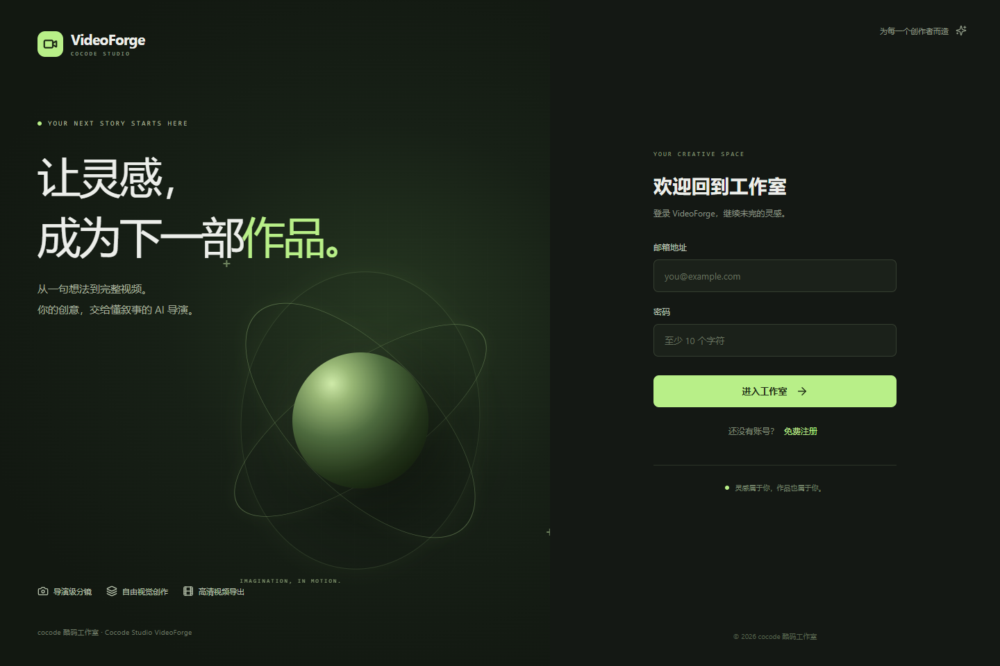
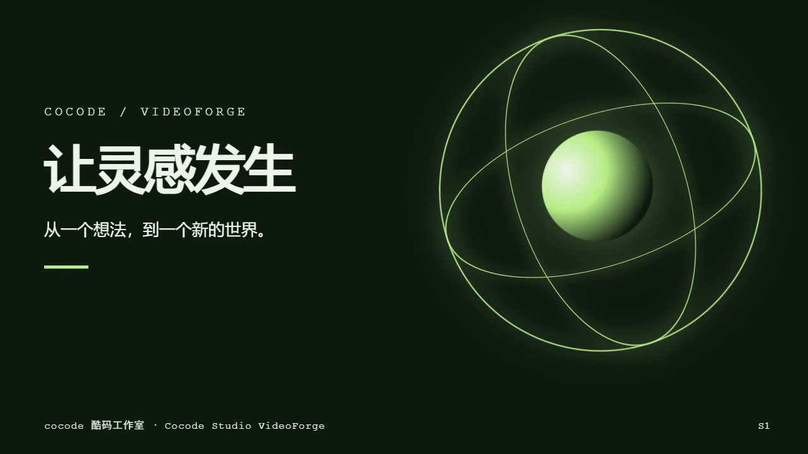

# cocode 酷码工作室 · Cocode Studio VideoForge — 验证记录
## 2026-10-10 自主创作 Harness（当前实现）

- 原生 DeepSeek 工具循环操作持久多文件工程，支持公开流式消息、途中修改、停止续作、版本、独立素材和工程 ZIP。
- HTML/SVG/Canvas/GSAP/Three.js/GLSL、React/TypeScript/Remotion 和 Blender 三条真实渲染路径均已生成影片；Python 图像处理、Node 文件权限执行、FFmpeg 和 edge-tts 实际运行通过。
- 完整模拟原生协议任务完成 21 次累计模型调用，包含一次故意渲染错误、诊断回传与修复，以及真实音视频合成、作品卡片和源码下载。记录在 `.test-artifacts/harness-smoke/result.json`，不是再次付费请求真实 DeepSeek。
- 全项目 43 项测试、类型检查、最终构建及独立打包插件检查通过；随后新增宿主评审凭据防伪检查并通过相关 4 项测试，总计 44 个不同测试通过。下载后的源码包也已解压并重新生成 MP4。
- ElevenLabs/MiniMax 使用本地协议样例验证音频解码、缓存、错误和服务时间戳，不冒充已配置的线上付费服务。Docker daemon 未运行，容器执行尚未实测。
- 能力和部署边界见 [创作 Harness](creative-harness.md)。以下保留旧版本历史证据。

## 2026-10-09 Agent harness 五阶段与自动修复（兼容实现）

- 五个专业阶段均由原生工具循环运行，AI 自主搜索及读取经 manifest/hash 校验的 Skill，记录工具轨迹与实际模型费用。
- 不限制 HTML 字符长度；截断后扩大输出窗口、完整重答，绝不渲染半份代码。支持同一个隔离样例从已完成阶段恢复。
- 整片检查、实际截图评审、导出形成反馈循环，最多共享两次内容修复；环境故障不触发代码改写。
- 官方 DeepSeek Flash 默认复用现有凭证进行图片理解，其他模型/代理需显式配置。可选媒体与配音网关接入，音乐由服务端实际合成。
- 本轮完整 38 项测试通过；随后新增无损音乐表归位兼容测试，与 agent/pipeline/whole-film 共 10 项相关测试通过；类型检查、构建、打包插件回归通过。
- 本地真实渲染测试片通过自动修复一次、15 秒 MP4 和音频导出，记录在 `.test-artifacts/creation-smoke/result.json`。它使用模拟模型，不能代替真实模型创作品质验收。
- 已授权真实样例记录在 `outputs/whole-film-1791549102475/sample-report.json`；实际遇到思考输出截断、结构偏差，保留失败和调用累计，不冒充首次通过。最终经两轮自动修复完成，运行检查、实际截图评审及 MP4 导出通过；成片为同目录「灵感成片-五阶段.mp4」。该结果是同一任务包含失败重答和恢复后的累计结果，不代表首次成功。

以下整片生产改造记录属于此前实现，不代表当前 harness 行为。

## 2026-10-09 整片生产改造

- 新生产队列已切换为一次调用生成方案、完整 HTML 总时间线和音乐事件表，不调用独立镜头生成，不生成接缝 ledger。
- motion-doctrine 单独前置；其余九个领域 Skill 保留完整正文及哈希。相机、转场和视觉母题元数据允许自由描述。
- 整片节拍不再限制每段 2–15 秒，允许一个叙事阶段贯穿 60 秒影片；持续运动方式允许自由描述。知识文档中的旧 LEFT 默认方向及跨文件接缝操作在整片契约中明确排除。
- TypeScript 检查与 27 项回归通过；其中生产队列测试实际记录模型 HTTP 请求只有一次，并验证没有镜头目录或 ledger 文件。
- DeepSeek 实际首次全片生成记录在 `outputs/whole-film/sample-report.json`，真实 API usage 显示 calls=1。首次结果未通过：MotionPathPlugin 未加载、系统字体缺少 local @font-face。原始画面和同次生成的音乐已导出，未进行模型修复，不宣称一次生成达到完美。
- 后续代码已提供本地 SDK 插件清单及文件，并明确插件加载与系统字体声明契约；这项依赖准备尚未用第二次真实生成冒充首次通过。
- 本地确定性测试片使用一个主时间线及 MotionPathPlugin，真实通过运行时、画面、文字、回退跳转与 15 秒 MP4 导出；这只证明渲染链可用，不替代真实模型首次质量验收。
- 当前版本另做一次独立 DeepSeek 任务，结果单独保存在 `outputs/whole-film-1791522673488`，不覆盖之前结果；仍只调用一次、没有修复。其完整输出被 `gsap_non_transform_motion` 检查拦截：播放指示线动画使用 `left` 布局属性。原样预览已导出，状态仍为未通过；不能据此声称一次生成已稳定达到完美。
- 桌面及手机参数菜单、素材上传和项目操作浏览器验收通过。TTS 按用户要求暂停。

下面是旧版本的历史记录，不能用它证明新整片路径已经全面通过。

验证日期：2026-09-05 至 2026-09-06。环境：Windows 11、Node.js 22.18.0、DSH 0.1.0-rc.6、Cordis 4.0.1、Hyperframes 0.8.29、FFmpeg 8.1.1。使用本机已安装的 Playwright Chrome Headless Shell，通过 `PRODUCER_HEADLESS_SHELL_PATH` 指定。

| 检查 | 结果 |
| --- | --- |
| `npm install` | 完成；最终配置固定 DSH 依赖及显式运行时 peer，`.npmrc` 避免循环 peer 自动解析 |
| `npm run typecheck` | 通过 |
| `npm test` | 5 组测试全部通过：数据隔离、认证/API/Range、队列成功失败、固定模型 HTTP 协议、自由代码语法 |
| `npm run build` | 三个 Node 插件、独立 React 前端、DSH client bundle 构建成功 |
| `npm run gates` | 固定三个插件配置通过；三个非法配置反例均被拒绝 |
| `npm start` | 原版 DSH CLI 真实启动，三个自有插件挂载，HTTP 3088 可访问 |
| `dsh --profile videoforge --dump-config` | 仅 cocode-data-store / cocode-director / cocode-studio-ui 三个业务条目，bundles 为空 |
| `npm run test:browser` | Edge 无头浏览器验证注册、登录后工作室、新建、重命名、参数、删除、登出；没有 pageerror |
| 桌面与手机 UI | 1440×960 和 390×844，截图人工查看；移动页无水平溢出 |
| `npm run test:render` | 真实 Hyperframes 渲染两个 1280×720 / 30fps 镜头，FFmpeg 淡化转场合成成功 |
| FFprobe | 最终 MP4 为 15.000 秒，H.264 输出，支持浏览器播放 |
| Hyperframes validate（镜头 s1） | 没有控制台错误；25 个文本检测项通过 WCAG AA |
| Hyperframes inspect（镜头 s1） | 5 个采样时间，0 个布局问题 |
| 成片截图 | `docs/video-frame.png`，已检查实际渲染文字与画面 |

## 实测边界

### 2026-09-06 控件与 500 修复回归

- `npm run check` 新增独立打包插件集成验证，匿名查询正常返回 200/null，业务错误保留 401、404、409、503，不误报 500。
- 浏览器验证自定义下拉的鼠标选择、Enter/Home/Escape、点击外部关闭、视觉风格与参数同步；已移除无用途的省略号。
- 空输入发送有可见提示；弹窗内显示服务端校验错误；未生成视频时显示明确的导出条件。
- 桌面及移动流程没有未捕获页面异常或 HTTP 500；下拉实际样式见 `dropdown-preview.png`。
- 项目三点菜单回归通过：重命名及删除非当前项目不会切换或关闭当前工作区；顶部远距离入口已移除，支持键盘打开和 Escape 关闭。截图见 `project-menu-preview.png`。

- 未获得本项目的真实模型 API Key，未调用外部付费模型。模型 HTTP 测试使用本地测试服务验证固定模型、认证头、分镜解析及自由 HTML 原样返回。真实渲染使用确定性 fixture HTML，仅替换测试中的模型输出函数；生产不使用该 fixture 回退。
- 测试成片为静音动态图形 MP4。项目未接入独立 TTS、音乐或真人视频模型，不声称已经具备这些供应商能力。
- Docker、Linux Nginx 与公网 HTTPS 没有在本机实际部署（本机未安装 Docker），提供了配置及步骤。
- Hyperframes 0.8.29 将 `validate` / `inspect` 标为 deprecated，当前仍能执行且实测通过；未来版本可迁移到 `check`，本项目锁定版本。
- 官方 DSH 的非加载适配器依赖 `@earendil-works/pi-ai` 安装时提示推荐 Node 22.19+，本项目在 Node 22.18 的实际加载链路通过。生产推荐 Node 22 最新补丁或 Node 24 LTS。
- JSON 存储限定单实例；不是分布式队列或数据库。服务重启将未完成任务标记失败，UI 可重新提交。

## 截图

